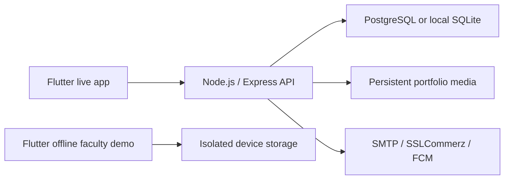

# JavaScript backend migration

The active stack is Flutter/Dart + Node.js/Express + PostgreSQL, with SQLite for
local development. The backend is entirely JavaScript ES modules. The retired
source, migrations, dependencies, test configuration and virtual environments
were removed from the working project. The original proposal PDF is retained
under `SkillConnect_Project_Proposal.pdf` as a historical scope document.

## Compatibility and preserved data

The Flutter frontend keeps the same `/api/` paths, snake_case JSON fields,
pagination format, JWT transport and multipart portfolio upload. The offline
faculty demo remains local Dart code and is independent of backend hosting.

This workspace's SQLite data was imported into
`backend/data/skillconnect.sqlite3`: 9 users, 7 profiles, 7 bookings, 6 reviews,
11 categories, 6 areas, 7 portfolio entries and 4 promotion packages. The previous
database is backed up at `backend/data/legacy.sqlite3`; photos remain in
`backend/media/`. Neither database nor private media is committed.

Existing password hashes are verified using Node cryptography. New and reset
passwords use scrypt. Old JWT sessions and recovery challenges are retired;
sign in again with your existing username and password. The import is read-only
on the source and refuses a non-empty target. It can import into PostgreSQL using
`DATABASE_URL` or into the default local SQLite database.

## Administration and integrations

The new browser console at `/admin/` signs in through the JWT API and calls
staff-only administration routes. User activation, profile verification,
catalogue/pricing edits, review moderation, manual promotion confirmation,
report resolution, booking monitoring and metrics are available.

SMTP email codes, optional FCM worker delivery and SSLCommerz checkout/validation
are JavaScript integrations. They still require your provider configuration.
No deployment or live provider verification is implied by this migration.

## Database integrity

The database schema uses foreign keys, unique review/quote links and checks for
valid booking states/durations. Marketplace writes use transactions. PostgreSQL
uses a transaction advisory lock across app instances; SQLite queues operations
and uses immediate write transactions. This serializes overlap checks and
idempotent acceptance/activation for the project's current scale. A larger
production workload should benchmark this strategy before scaling.

## Validation on 2026-10-13

- All 36 JavaScript tests passed in local SQLite and PostgreSQL 18 test runs.
  The legacy import test reads SQLite in both runs; CI uses PostgreSQL 16.
- JavaScript syntax and Prettier checks passed; the production dependency audit
  reported no known vulnerabilities.
- Flutter formatting, analysis and all 16 tests passed.
- The replacement server responded successfully on the computer's Wi-Fi address.
  The existing customer password was verified against the imported hash.
- No active project Python source or runtime remains. Media and database backups
  were retained outside Git. Provider credentials and physical-device UAT still
  require separate verification.

## Run and validate

```sh
npm ci
npm run migrate
npm run dev
npm run check
npm test
make check-mobile test-mobile
```

Tests use real HTTP endpoints and isolated local databases, with mocked payment,
email and push transports. CI repeats API tests against PostgreSQL. The local
SQLite module in Node 22 is marked experimental by Node; PostgreSQL is required
by production configuration.


