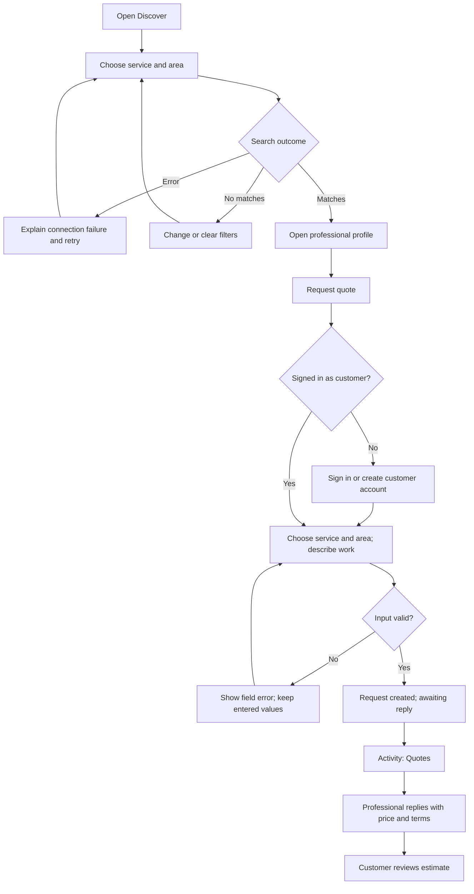
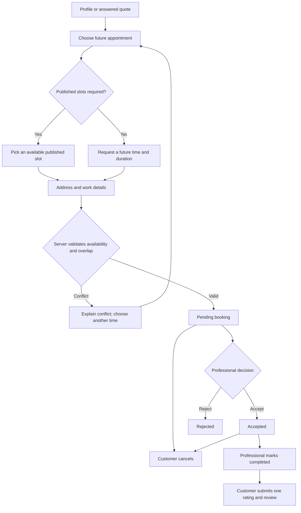
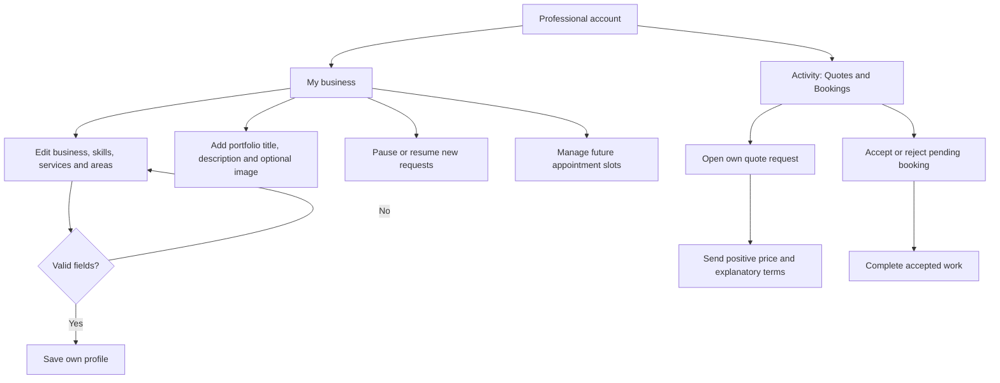
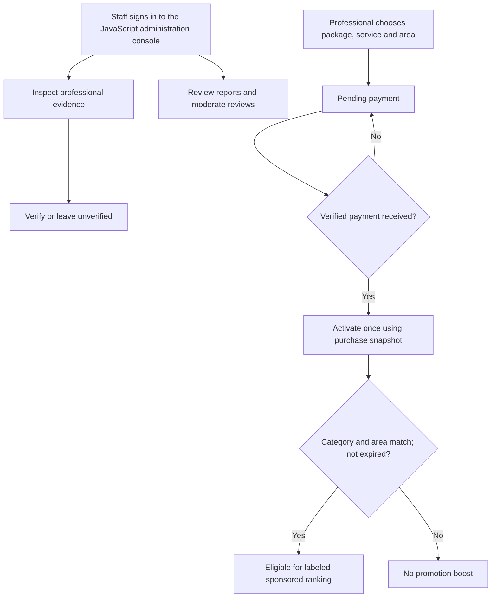

# 1.4 User flows & wireframes

These flows describe the product baseline and the design proposal. Real app
navigation is in `mobile/lib/main.dart`; customer screens in `discover.dart`,
`activity.dart` and `account.dart`; professional screens in `professional.dart`.
The prototype focuses on discovery/quotation and profile/availability. Booking,
reviews, promotions and full administration are documented for later sprint
handoff rather than simulated as complete products.

## Information architecture

```text
SkillConnect
├── Discover (guest and signed-in)
│   ├── Service / area / text / rating / availability / distance filters
│   ├── Results → compare 2–3 profiles or map
│   └── Professional → portfolio / reviews / contact
│       ├── Request quote → authentication gate → request
│       └── Book service → authentication gate → appointment → request
├── Activity (signed-in)
│   ├── Bookings → status / messages / review after completion
│   ├── Quotes → reply (professional) / accept estimate (customer) / messages
│   └── Reports → resolution
├── My business (professional only)
│   ├── Edit business / portfolio
│   ├── Availability switch / appointment calendar
│   └── Promotions / business metrics
├── Account
│   ├── Guest → sign in / register / password recovery
│   └── Signed-in → account / email verification / notification permission / logout
└── Toolbar → server connection; notifications when signed-in

Separate staff surface: Node.js /admin/
└── Users / professionals / categories / areas / bookings / reviews /
    packages / promotions / reports
```

## Customer discovery and quote journey — FR-01–05



Design proposal: preserve the intended action after sign-in. The current Flutter
profile/auth path should be checked before porting this behavior. In the prototype
the sign-in gate is a demo action and does not collect a password or create users.

## Booking and review journey — FR-08–09, FR-15



Rejected, cancelled and completed are terminal booking states. A quotation is not
a confirmed appointment. Quote acceptance snapshots the current price/terms and
creates a pending booking; a changed quote must be reloaded before acceptance.

## Professional journey — FR-05–07



Missing required fields keep the editor open. An unavailable professional should
not receive a new request. Pausing new requests does not erase existing work.
Verification remains a staff action. The prototype permits local profile edits,
availability changes and quotation replies; images/calendar are in the handoff.

## Staff and promotion process — FR-10–12



Staff sign-in, confirmation and verification are permission boundaries. The
prototype's Staff view is a labeled sample process screen, not the live administration UI.

## Low-fidelity mobile wireframes

Logical content width: 360–393px. Every screen scrolls above a persistent bottom
navigation bar. Actions remain reachable on small screens and with long content.

```text
DISCOVER                         RESULTS
┌───────────────────────────┐    ┌───────────────────────────┐
│ SkillConnect              │    │ ← Discover                │
│ A little help.             │    │ Electrician / Mirpur      │
│ Right around here.        │    │ Results count             │
│                           │    │ ┌───────────────────────┐ │
│ Service [Electrician   v] │    │ │ Name • verified       │ │
│ Area    [Mirpur        v] │    │ │ Skill / service area  │ │
│ Search  [             ]  │    │ │ Rating • starting BDT │ │
│ [Find professionals]      │    │ │ [View profile]        │ │
│                           │    │ └───────────────────────┘ │
│ Local professional sample │    │ [Change filters]          │
│ Discover Activity Account │    │ Discover Activity Account │
└───────────────────────────┘    └───────────────────────────┘

PROFILE                          REQUEST QUOTE
┌───────────────────────────┐    ┌───────────────────────────┐
│ ← Results                 │    │ ← Profile                 │
│ Professional name / badge │    │ Request a quote           │
│ Electrician / Mirpur      │    │ Professional name         │
│ Rating • experience       │    │ Service [              v] │
│ Starting price            │    │ Area    [              v] │
│ About / skills            │    │ Describe the work         │
│ Portfolio / review        │    │ [                       ] │
│ [Request quote]           │    │ [                       ] │
│                           │    │ Field error when needed   │
│ Discover Activity Account │    │ [Send quote request]      │
└───────────────────────────┘    └───────────────────────────┘

ACTIVITY                         MY BUSINESS
┌───────────────────────────┐    ┌───────────────────────────┐
│ Your quotes               │    │ Business name             │
│ ┌───────────────────────┐ │    │ Verification status       │
│ │ Request #Q001         │ │    │ [Available for requests]  │
│ │ Professional / work   │ │    │ [Edit business profile]   │
│ │ Status: awaiting reply│ │    │                           │
│ │ or price + terms      │ │    │ Services / areas / skills │
│ └───────────────────────┘ │    │ Starting price            │
│ Empty → Find professional │    │ Portfolio sample          │
│ Pro → Reply amount/terms  │    │ [Open quote requests]     │
│ Discover Activity Account │    │ Activity Business Account │
└───────────────────────────┘    └───────────────────────────┘
```

The interactive prototype offers the same screens in **Wireframe** mode. The
following screens are handoff wireframes for later sprint work, not clickable
features in the Sprint 1 prototype:

```text
BOOKING                          REVIEW / PROMOTION
┌───────────────────────────┐    ┌───────────────────────────┐
│ Book service              │    │ Review completed booking  │
│ Professional / service    │    │ Rating [1 2 3 4 5]        │
│ [Choose date & time]      │    │ Comment [               ] │
│ Address [               ] │    │ [Publish review]          │
│ Work    [               ] │    ├───────────────────────────┤
│ Price / accepted terms    │    │ Promote your business     │
│ [Request booking]         │    │ Service / area            │
│                           │    │ Package / duration / BDT  │
│ Pending → Accepted        │    │ [Confirm purchase]        │
│ → Completed → Review      │    │ Pending payment / Active  │
└───────────────────────────┘    └───────────────────────────┘
```

## State inventory

| Surface | Loading | Empty | Error | Success |
| --- | --- | --- | --- | --- |
| Discovery/results | Progress with status label | No matches; change filters | Could not connect; retry | Count + profiles |
| Profile | Progress | No portfolio/reviews yet | Retry or return to results | Evidence + request action |
| Quote form | Sending; prevent duplicate action | Required description | Field-specific correction | Request in Activity |
| Activity | Progress | No quote requests; find professional | Retry | Awaiting reply / answered amount and terms |
| Business edit | Loading/saving | Required fields prompted | Keep values; explain validation | Saved message and updated profile |
| Availability | Saving | N/A | Restore previous state if server save fails | Available / paused label |
| Staff verification | Saving | No pending records | Explain failed action | Updated badge and decision feedback |

Prototype state controls simulate loading, empty and offline results. Server-side
errors and save failures remain acceptance scenarios for the real app.
