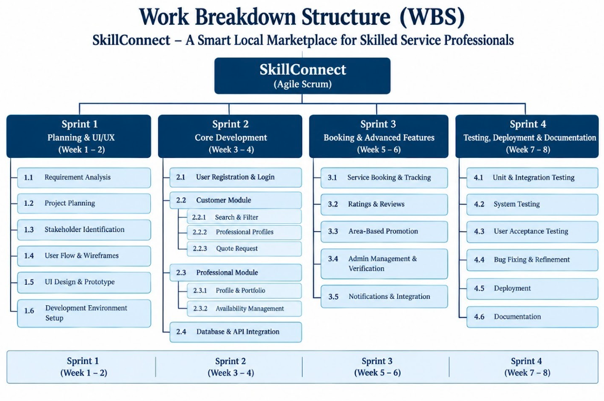

# SkillConnect Viva Preparation

## Read this first

Project management, software engineering and project-specific questions with short spoken answers. Prepared on 13 October 2026 for revision before the viva on 14 October 2026. This is a broad question bank, not a prediction of every question your faculty may ask.

Read the quick revision sheet first. Then study the starred questions, the WBS, the use-case cards and the worked calculations. Practice each answer aloud in 20-40 seconds. Use the pattern: **definition + SkillConnect example + reason or evidence**. Give your actual team members' names and dates when asked; the repository does not supply them.

**Evidence key:** Implemented = found in source; documented = found in the proposal/planning files; proposed = an example or future target. A feature being implemented does not prove live deployment, stakeholder approval or successful provider integration.

**Technology fact to get right:** The active project uses Flutter/Dart + Node.js/Express + PostgreSQL, with SQLite for local development. The Python/Django source has been retired; README, Makefile and CI use Node. The retained SkillConnect_Project_Proposal.pdf still describes Python as the historical choice. Explain this as an implementation change; distinguish the development model (Scrum), business model (freemium marketplace) and technology stack.

**Validation fact:** The latest fresh `npm test` run passed all 35 Node backend tests, including image upload. `npm run check` passed syntax and formatting checks. This guide did not change product source. Flutter results in project documents are historical; no fresh Flutter run is claimed here. Real-device UAT, public deployment and credential-dependent provider verification remain separate checks.

**Process fact:** WBS.png explicitly labels Agile Scrum and four two-week sprints. Planning documents use relative weeks, role-based owners and proposed ceremonies. There are no recorded named stakeholder approvals, completed interviews, actual velocity or full ceremony logs. Describe Scrum as the documented approach; do not invent evidence of every practice.

## Quick revision: the answers to learn tonight

| Faculty asks | Short answer to practice |
| --- | --- |
| What is SkillConnect? | A local marketplace connecting customers with skilled professionals through discovery, quotations, bookings, reviews and targeted promotions. |
| Which development model? | Agile, using a Scrum-based iterative and incremental plan; our WBS has four two-week sprints. |
| Why does it fit? | We can develop customer and professional journeys in small increments and adjust requirements after feedback. |
| Which business model? | A freemium two-sided marketplace, with paid category-and-area-specific professional promotions. |
| What is SRS? | Software Requirements Specification: the agreed description of scope, behavior, quality needs, interfaces and constraints. |
| What is your SRS evidence? | The proposal plus docs/sprint-1/REQUIREMENTS.md, with FR-01 to FR-17, NFR-01 to NFR-08 and acceptance criteria. It is a baseline, not a signed formal SRS. |
| What is WBS? | A hierarchy breaking project scope into manageable work packages; ours groups work into four sprint phases. |
| Requirements engineering? | Discover needs, analyze and prioritize them, document them, validate them and manage changes. |
| Main actors? | Guest, customer, professional and administrator; email/payment/push services can be supporting external actors. |
| Functional requirement? | A customer can book a professional for a future appointment and track its status. |
| Non-functional requirement? | Booking data must be private to authorized participants; performance and usability also have defined targets. |
| Constraint? | Eight-week planned duration, available team capacity, chosen technology and provider credentials. |
| Limitation? | No escrow/refunds, route distance, live GPS tracking or automatic identity-document verification. |
| Product backlog? | The ordered list of all product work, including features, defects, risks and technical improvements. |
| Sprint backlog? | The sprint goal, selected backlog items and Developers' plan to deliver them. |
| Sprint? | A fixed period for producing useful increments; our plan uses two weeks. |
| Scrum? | An Agile framework for organizing work, inspection and adaptation through accountabilities, events and artifacts. |
| XP? | Extreme Programming emphasizes engineering practices such as automated tests, refactoring and pair programming. |
| Booking states? | Pending -> accepted -> completed; pending can be rejected or cancelled, and accepted can be cancelled by the customer. |
| Exception example? | An overlapping booking is rejected; the customer must choose another appointment. |
| Can anyone review? | Only the owning customer, once per completed booking, with a rating from 1 to 5. |
| Is promotion payment live? | Integration code exists; live operation needs credentials, reachable callbacks and provider testing. Offline demo purchases are simulations. |
| Verification vs validation? | Verification checks the specification; validation checks whether the solution meets user needs. |
| Biggest release gap? | Real client/device UAT, measured production behavior and credential-dependent integration verification. |
| Best honest process answer? | The plan follows Scrum; evidence supports the artifacts and tests, but I will not claim ceremonies or user approvals without records. |

## 01. Project overview and business understanding

### Q001 [CORE] What problem does SkillConnect solve?
Customers struggle to compare local providers, and professionals struggle to reach nearby customers. SkillConnect combines searchable business profiles, requests, bookings, reviews and local promotion in one platform.

### Q002 [CORE] Explain your project in one minute.
SkillConnect helps customers discover and compare professionals by service and area, request quotations, book appointments and review completed work. Professionals manage profiles, availability and promotions. Staff control verification and moderation. The plan uses four Scrum-based sprints.

### Q003 Who are your target users?
Customers needing physical or digital services, independent professionals or small businesses offering them, and marketplace administrators who maintain trust and operations.

### Q004 What is the project's main objective?
Make local service discovery and booking easier while giving professionals a digital business identity and a practical way to attract relevant customers.

### Q005 [CORE] What is your business model?
The proposal defines a freemium two-sided marketplace: basic discovery and professional profiles are free, while professionals pay for time-bound promotions in selected service categories and areas.

### Q006 Development model and business model: what is the difference?
The development model explains how we build software: Agile with Scrum-based sprints. The business model explains how the platform creates value and earns revenue: free core use and paid promotions.

### Q007 What are the three main modules?
Customer: discovery, comparison, quotations, bookings and reviews. Professional: profile, portfolio, availability, replies and promotions. Administrator: catalog management, verification, moderation and reporting.

### Q008 What makes this project different from a simple booking app?
It also supports professional business profiles, portfolios, direct contact and service-and-area-specific promotion. The proposal combines customer convenience with professional business growth.

### Q009 What is a two-sided marketplace?
A platform serving two interdependent groups. SkillConnect needs customers seeking services and professionals providing them; value increases when both groups participate.

### Q010 What is the marketplace cold-start problem?
Customers need enough professionals, while professionals need customer demand. A proposed response is to start with a limited area and service set, recruit providers and measure real demand.

### Q011 What is your MVP?
Guest discovery, customer/professional authentication, profiles, quotations, booking tracking, completed-booking reviews, availability, promotions and administration. Recovery, messaging and advanced integrations are extensions in the requirements baseline.

### Q012 What is inside the project scope?
The software workflows for finding providers, managing service requests and professional visibility, plus staff control and deployment scaffolding. The platform does not itself perform the physical service.

### Q013 What is outside the project scope?
Escrow, refunds, route-based distance, live GPS tracking, automated identity-document verification, provisioning public hosting and a separate native staff application.

### Q014 Which areas, currency and language are used?
The demonstration uses configurable Dhaka areas, BDT and an English interface. Bangla localization is not currently implemented in the documented baseline.

### Q015 What are the promotion packages?
The seeded proposal packages are BDT 100 for 1 day, 300 for 7 days, 500 for 15 days and 800 for 30 days. Administrators can configure prices and durations.

### Q016 What is a project deliverable here?
A verifiable output such as the requirements register, prototype, API, Flutter app, tested booking workflow, release APK or deployment guide.

### Q017 How would you measure business success?
Proposed measures include successful request completion, repeat customers, active professionals, complaint rate and promotion revenue. The repository does not establish real market adoption or profitability.

### Q018 What evidence proves the system is useful?
The implemented journeys and tests demonstrate technical behavior. Actual usefulness still requires user feedback and acceptance; the stakeholder document proposes research but records no completed sessions.

## 02. Development model and alternatives

### Q019 [CORE] Which software development model do you use?
Agile with a Scrum-based iterative and incremental delivery plan. WBS.png labels Agile Scrum, and PLAN.md organizes the project into four two-week sprints.

### Q020 [CORE] Why did you choose this model?
Customer and professional needs may change after seeing the product. Short increments make feedback easier, expose integration problems earlier and let us prioritize the most valuable workflows.

### Q021 [CORE] How does Scrum suit SkillConnect specifically?
We can first clarify requirements and prototype journeys, then deliver authentication and discovery, then booking and promotions, and finally complete release checks. Feedback can change later priorities.

### Q022 What does iterative development mean?
Repeatedly improving a solution. For example, refine the discovery layout after testing whether customers can find the filters and understand profile information.

### Q023 What does incremental development mean?
Adding usable capabilities in pieces. For example, deliver authenticated discovery before adding booking, reviews and promotions.

### Q024 Are Agile and Scrum the same?
Agile is a set of values and principles for adaptive delivery. Scrum is a framework that can put those ideas into practice. XP is another Agile framework with stronger engineering prescriptions.

### Q025 Does the WBS prove you performed full Scrum?
It proves the chosen planning approach. Full Scrum execution would also need evidence of accountabilities, events, useful increments and inspection/adaptation; the repository does not record all of that.

### Q026 [CORE] Why not Waterfall?
Waterfall suits stable, well-understood requirements. SkillConnect has evolving interface and integration needs, so feedback between increments is useful. We still document scope and requirements.

### Q027 When would Waterfall be suitable?
When requirements and acceptance conditions are stable and changes are tightly controlled. It may fit a fixed specification better than an exploratory marketplace product.

### Q028 Why not the Spiral model?
Spiral is explicitly risk-driven and can be useful for major uncertainty. Its repeated risk-analysis structure would add overhead to this small academic project; we manage risks within the sprint plan.

### Q029 What is the V-model?
A development approach connecting specification and design levels to corresponding testing levels. It encourages early test planning, but a strict implementation is less flexible when product needs change.

### Q030 What is the role of prototyping?
Prototypes make flows and design assumptions visible before expensive implementation. SkillConnect has an independent Sprint 1 phone prototype with sample data and a wireframe mode.

### Q031 Is the prototype the final application?
No. The planning prototype illustrates flows locally; the Flutter app has its own implementation, and the live API provides shared multiuser behavior. The offline Flutter demo is another distinct simulation.

### Q032 Is Scrum a project-management framework or a programming technique?
Scrum organizes product development and team coordination. It does not specify language, database or coding methods; engineering practices must be selected separately.

### Q033 Can Scrum and XP be combined?
Yes. Scrum can organize goals and feedback while XP practices strengthen implementation quality. The repository supports automated tests and CI, but does not prove pair programming or test-first history.

### Q034 How do you handle requirements changing between sprints?
Record the change, assess value, effort, dependencies and risk, update requirements and tests, and reorder the backlog. Avoid silently expanding the scope or deadline.

## 03. SRS and requirements specification

### Q035 [CORE] What is SRS?
Software Requirements Specification. It documents what a system must do, its quality expectations, external interfaces, constraints and acceptance conditions so stakeholders can review a shared baseline.

### Q036 [CORE] Where is your project's SRS?
The repository has a proposal and docs/sprint-1/REQUIREMENTS.md containing scope, FR/NFR IDs, acceptance criteria and traceability. This is the available requirements baseline; a separately approved formal SRS is not shown.

### Q037 What should a complete SRS contain?
Purpose and scope, stakeholders, overall description, assumptions, functional requirements, quality requirements, interfaces, data rules, use cases, constraints, acceptance criteria and traceability.

### Q038 Why is an SRS necessary?
It reduces misunderstanding, controls scope and provides a basis for design and testing. A booking requirement should state valid actors and transitions so implementation and evaluation agree.

### Q039 What are the characteristics of a good requirement?
It should be clear, necessary, feasible, consistent, testable and traceable. Prefer one specific obligation over vague claims such as 'the application must be fast.'

### Q040 What is an ambiguous requirement?
A statement with multiple interpretations. 'Show nearby professionals' is ambiguous until we define the reference location, distance method and filtering behavior.

### Q041 What is an atomic requirement?
A requirement addressing one identifiable obligation. Separate registration, password reset and email verification so each can be implemented and tested independently.

### Q042 What is a verifiable requirement?
One with an objective check. 'Only the owning customer may review a completed booking once' can be checked through success, foreign-user, duplicate and incomplete-booking tests.

### Q043 What is a requirements baseline?
A reviewed version used as a reference for development and controlled changes. SkillConnect has a prepared baseline; named stakeholder approval is still an open item.

### Q044 What is a requirement ID?
A stable identifier such as FR-08 for booking and tracking. It links a requirement to design, code, tests, backlog items and changes.

### Q045 [CORE] What is a Requirements Traceability Matrix?
An RTM links requirements to their implementation and validation evidence. Example: FR-09 -> review serializer/route -> completed-booking and duplicate-review tests -> WBS 3.2.

### Q046 What is forward traceability?
Following a requirement into design, implementation and tests. It helps show that every agreed requirement is delivered and checked.

### Q047 What is backward traceability?
Following code or a test back to its requirement or justified change. It helps detect unnecessary scope and explain why a feature exists.

### Q048 SRS and design document: how do they differ?
SRS states required behavior and quality. Design explains how components, data structures and interfaces achieve it. In this repository, REQUIREMENTS.md and DESIGN.md have different purposes.

### Q049 SRS and WBS: how do they differ?
SRS defines the required product. WBS decomposes the work needed to deliver it. A review requirement becomes design, implementation and testing work under WBS 3.2 and Sprint 4 checks.

### Q050 Does Agile mean no SRS or documentation?
No. Agile values useful documentation alongside working software. SkillConnect needs written access rules, booking states and payment requirements because mistakes can affect users and data.

### Q051 What are external interface requirements?
Requirements about interaction with users, devices and other systems. SkillConnect has Flutter screens, a JSON REST API, image uploads and optional email, payment and push interfaces.

### Q052 How would you improve the current SRS?
Obtain stakeholder review, resolve open assumptions, define measured service levels, complete interface/error details and maintain a fuller requirement-to-test matrix. Do not replace evidence gaps with invented approvals.

## 04. Requirements engineering and stakeholder work

### Q053 [CORE] What is requirements engineering?
The systematic process of eliciting, analyzing, specifying, validating and managing stakeholder needs and system requirements throughout the project.

### Q054 [CORE] How did you identify requirements for this project?
The documented analysis uses the proposal, supplied WBS, existing documents, source and tests. Stakeholder interviews are proposed, but no completed interview findings are recorded.

### Q055 What is elicitation?
Discovering stakeholder needs through methods such as interviews, observation, workshops, document analysis and prototypes. In SkillConnect, document and code analysis provide the existing evidence.

### Q056 Which elicitation methods would be useful here?
Interview customers and professionals, observe provider-search behavior, review complaint handling with staff and run prototype tasks. These would validate assumptions about trust, pricing and availability.

### Q057 What does your stakeholder research plan propose?
Three customers, three professionals and one administrator, with 20-30 minute sessions. This is a proposed formative sample, not completed research or a representative market survey.

### Q058 What is requirements analysis?
Checking needs for conflicts, duplication, feasibility, priority and dependencies. For example, decide how customer booking freedom interacts with a professional's published-slot restrictions.

### Q059 Give a conflict between stakeholders.
A professional may want maximum paid visibility, while customers want quality results. SkillConnect limits the sponsorship boost, labels sponsored profiles and retains rating and distance sorting.

### Q060 What is requirements negotiation?
Resolving conflicting needs into an agreed, feasible decision. For example, support manual promotion payment confirmation when live gateway setup cannot fit the initial delivery constraints.

### Q061 [CORE] What is requirements validation?
Checking that requirements are understandable, consistent, feasible and reflect stakeholder needs. Reviews, prototype walkthroughs and acceptance scenarios help; passing code tests alone cannot prove user agreement.

### Q062 What is requirements management?
Maintaining IDs, versions, priorities, dependencies and change history. A booking-rule change should update its requirement, affected API/UI, tests and backlog entry together.

### Q063 What is MoSCoW prioritization?
Must, Should, Could and Won't for the relevant time period. SkillConnect's register uses Must and Should, plus Extension as a scope label; Extension is not a standard MoSCoW category.

### Q064 What is an assumption?
Something believed true until confirmed. Examples include English UI being acceptable, Dhaka demonstration areas being suitable and manual promotion confirmation remaining usable.

### Q065 What is a dependency?
Something work relies on. Reviews depend on completed bookings; booking ownership depends on authentication; live push depends on Firebase/APNs configuration.

### Q066 What is feasibility analysis?
Assessing whether a proposal is achievable technically, operationally, economically and within the schedule. Existing code demonstrates some technical feasibility; live operation and business viability still need validation.

### Q067 What is RACI?
Responsible performs the work; Accountable owns the decision; Consulted provides input; Informed receives updates. The stakeholder document assigns these roles without naming team members.

### Q068 What is stakeholder analysis?
Identifying who is affected, their needs, influence and involvement. Customers, professionals, administrators, the sponsor and faculty need different review activities.

### Q069 How would you handle a new Bangla-language requirement?
Clarify languages and affected screens, estimate localization and testing work, assess the deadline, obtain a priority decision and update the backlog. It is a proposed change, not an existing feature.

### Q070 What is an acceptance criterion? Give one.
A specific condition for accepting work. Given an owned completed booking, the customer may submit one rating from 1 to 5; duplicate or foreign-booking reviews are rejected.

## 05. Functional requirements and business rules

### Q071 [CORE] What is a functional requirement?
A required behavior or capability. SkillConnect must let a customer search professionals by category and area, request a quotation and create a valid booking.

### Q072 List the main functional requirements.
Registration/login, guest search, profile comparison, quote request/reply, business and portfolio editing, availability, booking tracking, reviews, promotions, administration, notifications and reports.

### Q073 Can guests use the system?
Guests can browse catalogs, search and inspect public profiles. Protected actions such as creating bookings or quotation requests require authentication and the appropriate role.

### Q074 How are customer and professional accounts different?
Customers initiate service requests and review completed work. Professionals manage their business information, availability, quotation replies, booking decisions and promotions.

### Q075 Can a user register as an administrator?
Public registration must not grant staff privileges. Backend checks prevent role/staff escalation; administrative access is provisioned through trusted operational procedures.

### Q076 What search options are implemented?
Service category, area, text, minimum rating and availability filters, with recommended, rating and distance sorting. Coordinates support distance filtering; Flutter uses the selected area's location.

### Q077 How does profile comparison work?
The Flutter interface lets customers compare selected professional profiles, up to three. Relevant information includes ratings, experience, starting price, availability and profile evidence.

### Q078 How do quotation requests work?
A customer selects an offered service and served area and describes the work. Only the requested professional can reply with a positive estimate and included-work terms.

### Q079 [CORE] What happens when a customer accepts a quotation?
The system verifies the current quotation revision, records a snapshot of price and terms and creates one linked booking. The booking still requires professional acceptance.

### Q080 What is the booking lifecycle?
A new booking is pending. The professional can accept or reject pending work and complete accepted work. The customer can cancel pending or accepted work; terminal states cannot be reopened.

### Q081 What does professional availability mean?
A professional can pause new requests. This does not remove previously accepted work. Published appointment slots can also restrict booking times when scheduling is enabled.

### Q082 [CORE] What are the review rules?
Only the owning customer can review a completed booking, once, with a rating from 1 to 5. Staff can hide a review; hidden reviews are excluded from public rating calculations.

### Q083 How do promotions work?
A professional selects a package, category and area. Purchase snapshots price and duration; payment confirmation starts the promotion. Sponsorship applies only to matching searches while active.

### Q084 How does professional verification work?
Authorized staff decide whether to mark a professional verified. The professional cannot self-verify. The badge represents a staff decision, not an automatic guarantee of service quality.

### Q085 What can administrators do?
Manage users, service/area catalogs and packages; verify professionals, moderate reviews, monitor requests and resolve reports. The active implementation uses a Node browser admin console with staff-protected APIs.

### Q086 What notifications and messaging exist?
Request changes and messages create in-app notifications. Private conversations belong to booking or quotation participants. Native push requires separate provider setup and device permission.

### Q087 What account-recovery functions exist?
Email verification and password reset use expiring single-use codes, attempt limits and session revocation after reset. Console email and offline demo codes are development simulations.

### Q088 What is a business rule, compared with a feature?
A feature is a capability, such as reviewing services. A business rule controls when it is allowed, such as one review only after an owned booking is completed.

## 06. Non-functional requirements

### Q089 [CORE] What is a non-functional requirement?
A quality expectation or operating condition. Examples are privacy, security, responsiveness, accessibility, reliability and reproducible deployment.

### Q090 [CORE] Give three non-functional requirements from this project.
Restrict private requests to authorized participants; preserve valid booking/payment data under failures; provide usable mobile layouts and clear error recovery. Performance also has a proposed measurable target.

### Q091 How does the project address security?
Passwords are hashed, JWTs authenticate requests, role/ownership checks protect operations and the client stores tokens securely. Production configuration needs HTTPS, restricted origins and protected secrets.

### Q092 Authentication and authorization: what is the difference?
Authentication confirms who a user is. Authorization decides what that user may do. A logged-in customer must still be denied access to another customer's private booking.

### Q093 What is your performance requirement?
NFR-07 proposes discovery responses within one second across 20 warm seeded-local requests. That target was not benchmarked in the planning baseline and is not a production performance guarantee.

### Q094 What is reliability in SkillConnect?
Requests should preserve consistent data and recover predictably. Duplicate quotation acceptance returns the same booking; payment confirmation must not extend an already activated promotion.

### Q095 What is availability as a software quality?
The ability of the service to be accessible when needed. It differs from a professional's work availability. No measured production uptime SLA is established in the repository.

### Q096 What is usability?
How easily users can complete goals and recover from mistakes. SkillConnect's tasks include finding a provider, requesting a quote and locating its status with understandable labels.

### Q097 What accessibility needs are documented?
Labeled inputs, visible keyboard focus, status text in addition to color, at least 44px prototype touch targets and a goal of AA text contrast. A complete accessibility audit remains open.

### Q098 What is maintainability?
How easily software can be understood, changed and checked. Modules, readable API contracts, requirement IDs, migrations and automated tests support it; stale documents weaken it.

### Q099 What is scalability? Is it proved?
Handling increased users and workload without unacceptable degradation. PostgreSQL support provides a deployment option, but large-scale capacity is unproven; the newer backend also has broad write serialization and in-memory filtering.

### Q100 What is data integrity?
Keeping data accurate and relationships valid. Foreign keys, unique booking-review relationships, state validation and transactional booking/payment operations help enforce SkillConnect's rules.

### Q101 How do you test a non-functional requirement?
Use measurable checks: foreign-user access tests for privacy, timed discovery requests for performance, narrow-screen tasks for usability and concurrent booking tests for integrity.

### Q102 Functional or non-functional: 'only participants can read messages'?
It is a functional access-control rule supporting the non-functional privacy objective. Classification can overlap; define the observable behavior and test it clearly.

## 07. Use cases, actors and modeling

### Q103 [CORE] What is a use case?
A description of how an actor interacts with the system to achieve a goal. 'Book a professional' includes its trigger, preconditions, main flow, alternatives and outcome.

### Q104 [CORE] Who are the actors in SkillConnect?
Guest, customer, professional and administrator are human actors. Payment gateway, email service and push provider can be supporting external actors when those integrations are used.

### Q105 What is a primary actor?
The actor pursuing the goal. A customer is the primary actor for requesting a quotation; the professional participates when replying.

### Q106 What is a supporting actor?
An external participant providing a service to the system. SSLCommerz supports promotion checkout; it is not the professional initiating the purchase.

### Q107 What is the system boundary?
The boundary defining what SkillConnect implements. Customer/professional applications and backend workflows are inside; physical service delivery and external provider systems are outside.

### Q108 Give five main customer use cases.
Search professionals, compare profiles, request a quotation, book and track a service, and review completed work. Messaging and reporting support these journeys.

### Q109 Give five professional use cases.
Maintain a profile, manage portfolio and availability, reply to a quotation, accept/complete bookings, and purchase targeted promotion.

### Q110 Give four administrator use cases.
Verify professionals, manage catalogs/packages, moderate reviews and resolve reports. Staff can also monitor marketplace activity and confirm manual promotion payments.

### Q111 [CORE] Explain the booking use case briefly.
A signed-in customer selects a professional, service, area, future time and address. The backend validates ownership rules and availability, creates a pending booking and notifies the professional.

### Q112 What is a precondition?
A condition that must already hold before a use case starts. For booking, the actor must have a customer account and the selected professional/service must be available for the request.

### Q113 What is a postcondition?
A condition after the use case finishes. Successful booking leaves one pending request with the correct participants and appointment reservation; failure leaves no partial booking.

### Q114 What is an alternative flow?
A valid variation from the main flow. A customer can book directly or accept a replied quotation; both lead to a booking, but quotation acceptance carries agreed price/terms.

### Q115 What is an exception flow?
A failure or blocked path. If the selected time overlaps a reservation, reject booking and explain that the customer must choose another appointment.

### Q116 What is UML include?
A relationship where one use case incorporates another's behavior. A proposed model could have booking include schedule validation. Treat login as a precondition if the user is already authenticated.

### Q117 What is UML extend?
A conditional addition at an extension point. A proposed 'Show sponsored results' behavior can extend discovery when matching paid active promotions exist. This is modeling guidance, not an existing UML artifact.

### Q118 Use case, user story and sequence diagram: how do they differ?
A use case details an actor-system flow; a user story states value concisely; a sequence diagram shows message order between components. They describe related work at different levels.

## 08. Exceptions and failure handling

### Q119 [CORE] What do you mean by an exception?
An unexpected runtime failure or a use-case failure path. In SkillConnect, invalid input, unauthorized access, unavailable providers and failed external services need predictable handling.

### Q120 How are validation failures handled?
The backend rejects invalid requests with explanatory errors; the Flutter API converts error responses into ApiException for the UI. An unsuccessful request must not silently create partial records.

### Q121 What happens when a guest tries to book?
Authentication is required for protected API actions. The interface should guide the guest to sign in; the backend still enforces the rule if the UI is bypassed.

### Q122 What happens when a professional is unavailable?
New service requests are rejected with a clear availability message. Existing work remains accessible; the customer can choose another provider or try again later.

### Q123 [CORE] What if two customers book the same time?
The active Node backend validates conflicts inside serialized write transactions. PostgreSQL uses a transaction advisory lock; SQLite queues operations with immediate transactions. Concurrent tests exercise conflicts, but production load still needs evaluation.

### Q124 What if the quotation changed before acceptance?
The customer submits the quotation revision. A stale revision is rejected so the customer must refresh and accept the current estimate; old pricing is not silently substituted.

### Q125 What if the customer presses Accept estimate twice?
Acceptance is idempotent: the already linked booking is returned. A unique quotation-to-booking relationship and transaction checks help avoid duplication.

### Q126 What if someone reviews an incomplete booking?
The backend rejects the request. Review creation requires the owning customer and a completed booking; a duplicate review is also blocked.

### Q127 What if an outsider reads private messages?
Participant checks deny access. Private conversation information is not made available merely because a user knows or guesses its booking/quotation identifier.

### Q128 What if the payment browser says success?
A browser return alone cannot activate a promotion. The backend must independently verify provider status, transaction/validation identifiers, currency and the expected amount.

### Q129 What if a payment callback is received twice?
Confirmation must be idempotent. An already activated promotion is not extended again; repeated callbacks should preserve the original recorded activation.

### Q130 What if an email code expires or is guessed repeatedly?
Codes expire after 15 minutes and lock after five wrong attempts. Resending invalidates earlier codes; successful use consumes the code.

### Q131 What if the live server is unreachable?
The Flutter app keeps its layout visible and presents connection/retry guidance. The separate offline demo supports local sample workflows but does not synchronize real customer/professional data.

### Q132 What if native push fails?
In-app notifications remain available. The worker tracks each device, retries failed deliveries and removes invalid tokens. At-least-once delivery means a crash can still cause duplicates.

### Q133 What if an image upload is invalid?
The backend rejects invalid image content and unauthorized changes. The latest image-upload test passes for a valid image and checks invalid files and foreign deletion. This is API evidence, not a complete real-device release check.

### Q134 Which HTTP statuses should you understand?
200 success, 201 created, 204 success without a body, 400 invalid request, 401 missing/invalid authentication, 403 forbidden, 404 missing or hidden resource, 429 rate limit and 500 server failure.

## 09. WBS and scope decomposition

### Q135 [CORE] What is a Work Breakdown Structure?
A hierarchical decomposition of project scope into manageable work packages. It helps organize deliverables, assign responsibility, estimate effort and check coverage.

### Q136 [CORE] Explain your project's WBS.
SkillConnect is decomposed into Sprint 1 planning/UI, Sprint 2 core development, Sprint 3 booking/advanced features and Sprint 4 testing/deployment/documentation, covering planned weeks 1-8.

### Q137 What are the levels of your WBS?
Root: SkillConnect. Next level: four sprint phases. Lower levels: work packages such as customer module, then search/filter, professional profiles and quotation request.

### Q138 What is a work package?
A manageable lowest-level unit of WBS scope that can be estimated and checked. WBS 2.2.3 is quotation request; its activities can include UI, API and tests.

### Q139 What is the 100% rule?
The WBS should cover all agreed project scope, including supporting work, without overlap or missing work. Changes must be reflected in scope coverage and planning.

### Q140 [CORE] What belongs to Sprint 1?
Requirements analysis, project planning, stakeholder identification, user flows/wireframes, UI design/prototype and development environment setup: WBS 1.1-1.6.

### Q141 [CORE] What belongs to Sprint 2?
Registration/login, customer search/profiles/quotes, professional profile/portfolio/availability and database/API integration: WBS 2.1-2.4 with customer/professional subpackages.

### Q142 [CORE] What belongs to Sprint 3?
Booking/tracking, ratings/reviews, area-based promotion, admin management/verification and notifications/integration: WBS 3.1-3.5.

### Q143 [CORE] What belongs to Sprint 4?
Unit/integration testing, system testing, UAT, bug fixing/refinement, deployment and documentation: WBS 4.1-4.6.

### Q144 Is your WBS a fully deliverable-oriented WBS?
It is mainly organized by sprint phase and activity groups. It is useful for academic planning, but can be improved by defining explicit deliverables and acceptance criteria for each leaf.

### Q145 WBS and Gantt chart: what is the difference?
WBS describes scope decomposition. A Gantt chart places activities on a timeline with durations and dependencies. The WBS's week labels do not replace a detailed schedule.

### Q146 WBS and product backlog: what is the difference?
WBS structures total project work. The backlog is an evolving ordered list of product work. A backlog item can map to a WBS package without being identical to it.

### Q147 What is a WBS dictionary?
A description of each work package's scope, output, owner, acceptance criteria, assumptions and exclusions. It makes short WBS labels operationally clear.

### Q148 Give a WBS dictionary example.
WBS 3.2: deliver completed-booking reviews; backend/mobile roles implement it; acceptance requires one owned completed-booking rating and correct moderation behavior. Dependencies are authentication and booking completion.

### Q149 Can the WBS change?
Yes, through an agreed scope change. Adding localization should create or modify work packages and update estimates, dependencies and the backlog rather than disappear inside unrelated tasks.

### Q150 Does grouping testing in Sprint 4 mean no earlier testing?
No. Every increment should be checked as it is built. Sprint 4 includes broader integration, system, UAT and release checks; postponing all testing would weaken Agile delivery.

## 10. Schedule, estimation and project controls

### Q151 [CORE] What is the planned project duration?
Eight weeks divided into four two-week sprints. These are relative planning periods; actual dates, individual commitments and full team capacity are not supplied.

### Q152 What is effort, compared with duration?
Effort measures work, such as eight person-days. Duration measures elapsed time. Parallel work, dependencies and delays mean eight person-days do not automatically equal eight calendar days.

### Q153 What is your Sprint 1 effort estimate?
PLAN.md estimates eight focused person-days, with two days reserved for review delays/fixes in a ten-working-day single-person schedule. It is an initial estimate, not actual recorded effort.

### Q154 What is a milestone?
A significant review or completion point, normally with zero duration in a schedule. Examples are approving the requirements baseline, demonstrating booking end-to-end and accepting a release.

### Q155 What is a dependency chain here?
Identity and profiles support service requests; bookings support completion; completion supports valid reviews. Promotion activation also depends on payment confirmation.

### Q156 What is the critical path?
The longest dependency path determining minimum project duration. A real critical path requires an activity network and estimates; our WBS alone does not establish it.

### Q157 What is float or slack?
The time an activity can slip without delaying a specified milestone or project finish. An activity with zero total float is normally critical in a simple deterministic schedule.

### Q158 What is PERT estimation?
A three-point estimate using optimistic, most likely and pessimistic durations. Expected duration = (O + 4M + P)/6; the appendix gives a clearly hypothetical example.

### Q159 What are story points?
A relative estimate of complexity, effort and uncertainty. They are not universal hours and are meaningful within a team's estimation approach.

### Q160 What is planning poker?
A collaborative estimation technique where team members reveal estimates and discuss differences. It can expose uncertainty, but the repository does not record its use.

### Q161 What is velocity?
Completed story points per sprint under a consistent team definition. It supports forecasting, not comparing individual performance. SkillConnect has no recorded historical velocity.

### Q162 What is the iron triangle?
Scope, time and cost/resources are interdependent. With a fixed academic deadline and limited capacity, prioritize scope while preserving essential quality and security.

### Q163 What is scope creep?
Uncontrolled additions without an agreed adjustment to resources, schedule or priorities. Adding escrow or live tracking before the viva would create unplanned scope.

### Q164 What are crashing and fast-tracking?
Crashing adds resources to shorten critical work; fast-tracking overlaps activities that were sequential. Both can increase cost or risk and require realistic dependencies.

### Q165 What are earned value metrics?
PV is budgeted planned work, EV is budgeted completed work and AC is actual cost. CPI = EV/AC; SPI = EV/PV. These are academic control concepts, not measured SkillConnect figures.

### Q166 What is project closure?
Confirm accepted scope, hand over artifacts and operations instructions, record unresolved issues and lessons, and close responsibilities. A runnable demo alone does not equal accepted production handover.

## 11. Product backlog, stories and prioritization

### Q167 [CORE] What is a product backlog?
The ordered list of work needed to improve a product. SkillConnect items can include features, defects, research, documentation, integrations and technical debt.

### Q168 [CORE] What is a sprint backlog?
The sprint goal, selected product backlog items and the Developers' plan to deliver them. It is more than a fixed task list and is updated as work is learned.

### Q169 Product backlog and sprint backlog: who manages them?
The Product Owner is accountable for product backlog management. Developers manage their sprint delivery plan. The project documents identify role-based owners but do not name actual people.

### Q170 What is a user story?
A concise expression of user value, commonly 'As a [user], I want [capability], so that [benefit].' It needs discussion and acceptance criteria to guide implementation.

### Q171 [CORE] Give a SkillConnect user story.
As a customer, I want to filter electricians by area and rating so that I can find a suitable nearby provider. Acceptance checks should cover matching results, empty results and invalid filters.

### Q172 Give a professional user story.
As a professional, I want to pause new requests so that I can manage workload. Acceptance requires new requests to fail while previous bookings remain visible.

### Q173 Give an administrator user story.
As an administrator, I want to hide an inappropriate review so that public information remains useful. Hidden reviews must also stop contributing to public rating calculations.

### Q174 What is an epic?
A broad piece of value split into smaller items. 'Service booking' can split into schedule selection, request creation, acceptance/rejection, completion, cancellation and notifications.

### Q175 Epic, story and task: how do they differ?
An epic groups substantial value, a story describes a smaller user outcome, and tasks describe implementation work. For booking, tasks can cover an API rule, a Flutter form and tests.

### Q176 What is backlog refinement?
Clarifying items, splitting large work, defining acceptance criteria, examining dependencies and improving estimates. It is ongoing work, not a separately required formal Scrum event.

### Q177 How do you prioritize the backlog?
Consider user value, risk, dependencies and capacity. Identity and request integrity come before optional integrations; real-user acceptance and provider checks deserve priority before production release.

### Q178 What does INVEST mean?
Independent, Negotiable, Valuable, Estimable, Small and Testable. It is a useful story-quality checklist, not proof that every repository item already follows it.

### Q179 What is Definition of Ready?
A team's optional checklist for understanding work before starting: actor, goal, acceptance, error handling and dependencies. It is not a mandatory artifact in the Scrum Guide.

### Q180 [CORE] Definition of Done and acceptance criteria: what is the difference?
Acceptance criteria describe an item's expected behavior; Definition of Done sets shared quality conditions for an increment. A review story's criteria are distinct from review, tests, integration and documentation checks.

### Q181 What are technical debt backlog items?
Work needed to reduce future maintenance cost or risk. Examples are aligning documentation/CI with the chosen backend and improving broad transaction locking or discovery-query efficiency.

### Q182 What should happen to unfinished sprint work?
It is not counted as Done. Return/reconsider it in the product backlog and replan based on remaining work and priority; do not silently claim a completed increment.

### Q183 Can a backlog contain bugs and research?
Yes. Product improvement includes fixing defects, learning about user needs and reducing technical uncertainty, not only adding visible features.

### Q184 Is a sample backlog an actual commitment?
No. The appendix's next-sprint backlog is a proposed preparation tool. Actual commitments require the chosen scope, available people, priorities and agreed acceptance conditions.

## 12. Scrum, sprints and team practice

### Q185 [CORE] What is Scrum in one sentence?
A lightweight framework for developing complex products through a small team, short feedback cycles and useful increments.

### Q186 What are the Scrum pillars?
Transparency, inspection and adaptation. For SkillConnect: expose real status, review working journeys and change the plan when evidence reveals problems.

### Q187 What are the five Scrum values?
Commitment, focus, openness, respect and courage. A practical example is openly reporting an incomplete test or integration rather than overstating readiness.

### Q188 [CORE] What are the Scrum accountabilities?
Product Owner, Scrum Master and Developers. The repository names planning roles but does not establish actual assigned Scrum personnel.

### Q189 What does the Product Owner do?
Owns product value and backlog ordering. For this project, that means deciding whether release integrity, user feedback or an additional feature deserves priority.

### Q190 What does the Scrum Master do?
Helps establish Scrum and improve team effectiveness. Examples include facilitating useful events and helping remove blockers; this is not simply assigning programming tasks.

### Q191 What do Developers do?
Build the increment, maintain the sprint plan and shared quality. In this project the work includes backend, Flutter, tests, design and integration tasks.

### Q192 [CORE] What is a sprint and how long is yours?
A fixed development period. The documented SkillConnect plan chooses two weeks, with four sprints over eight weeks.

### Q193 What are the Scrum events?
The Sprint contains Sprint Planning, Daily Scrum, Sprint Review and Sprint Retrospective. Refinement supports the work but is not a separate formal event.

### Q194 What happens in Sprint Planning?
Agree the sprint's purpose, select feasible work and plan delivery. A proposed release sprint could focus on a dependable faculty demonstration and documented known gaps.

### Q195 What is the Daily Scrum?
A 15-minute Developers' event to inspect progress toward the sprint goal and adapt the plan. It is not primarily a manager's status meeting.

### Q196 What happens in a Sprint Review?
Inspect the outcome with stakeholders and discuss future adaptation. SkillConnect can demonstrate customer/professional journeys and collect decisions about the next backlog priorities.

### Q197 What happens in a Sprint Retrospective?
Inspect how the team worked and identify improvements. For example, prevent documentation drift by including affected documents in each change's completion checks.

### Q198 [CORE] Review and retrospective: how do they differ?
Review examines the product and future direction with stakeholders. Retrospective examines team process and quality practices to improve the next sprint.

### Q199 What are the Scrum artifacts and commitments?
Product Backlog with Product Goal; Sprint Backlog with Sprint Goal; Increment with Definition of Done. Each pairs a visible artifact with a focus for inspection.

### Q200 What is a Product Goal for SkillConnect?
A proposed goal is to make local professional discovery and service requests useful and trustworthy for both marketplace sides. The repository does not record an agreed Scrum Product Goal statement.

### Q201 [CORE] What is a Sprint Goal example?
For Sprint 2: enable customers to find professionals and submit valid private quotation requests. It focuses on an outcome rather than only completing unrelated tasks.

### Q202 What is an increment?
A usable, integrated addition to the product meeting the Definition of Done. Planning documents support delivery, but a planning-only sprint does not itself demonstrate a usable product increment.

### Q203 Can work change during a sprint?
The delivery plan can adapt as understanding changes, while protecting the sprint goal. New requests require discussion about impact and priority rather than uncontrolled additions.

### Q204 Can a sprint be cancelled?
The Product Owner can cancel it if its goal becomes obsolete. Ordinary bugs or difficulty are normally handled by adaptation, not automatic cancellation.

### Q205 What is a burndown chart?
A chart of remaining work over time. It can show progress, but it is optional and may hide added scope; no actual SkillConnect burndown is recorded.

### Q206 How would you apply Scrum honestly to a small academic team?
Use clear roles, short goals, visible work, frequent checks and real review decisions. If one person holds several responsibilities or events were informal, describe that accurately instead of claiming perfect Scrum compliance.

## 13. XP and engineering practices

### Q207 [CORE] What is XP?
Extreme Programming is an Agile approach emphasizing disciplined software engineering and close feedback to improve software quality.

### Q208 [CORE] Scrum and XP: how do they differ?
Scrum emphasizes organizing product work and adaptation. XP gives stronger guidance about coding and feedback practices. They can be combined without being interchangeable.

### Q209 What are XP's five values?
Communication, simplicity, feedback, courage and respect. In SkillConnect, understandable rules and honest test evidence support these values.

### Q210 Name important XP practices.
Automated testing, test-first development, pair programming, continuous integration, refactoring, simple design, small releases and collective ownership.

### Q211 [CORE] What is Test-Driven Development?
Write a failing test, implement enough behavior to pass it, then refactor. A duplicate-review test is useful, but test-first development cannot be inferred merely from the presence of tests.

### Q212 What is pair programming?
Two developers work together, commonly with driver and navigator responsibilities. It can help review subtle booking/payment logic; there is no record proving it was used here.

### Q213 What is refactoring?
Improving internal structure while preserving observable behavior. Extracting shared ownership validation can reduce duplication if behavior tests still pass.

### Q214 What is continuous integration?
Frequently integrating changes and automatically checking them. The current GitHub Actions workflow checks the Node backend with SQLite and PostgreSQL, and runs Flutter checks/builds. Workflow configuration alone does not prove a remote run passed.

### Q215 What is simple design?
Build what current requirements need, keep it understandable and remove unnecessary complexity. It does not mean ignoring security, concurrency or future maintenance.

### Q216 What is collective code ownership?
The team can improve any part of the code using agreed checks and standards. It requires coordination, review and accountability, not uncontrolled editing.

### Q217 What are small releases?
Frequent limited improvements that can be evaluated. The repository's APK/demo revisions demonstrate small release changes, though they do not prove a complete XP process.

### Q218 What is sustainable pace?
A workload the team can maintain without long-term exhaustion and declining quality. Preserve essential checks and reduce optional scope rather than repeatedly relying on emergency work.

### Q219 What XP-related practices are evidenced here?
Automated tests, code formatting/checks and an existing CI workflow are present. The source does not prove pair programming, an on-site customer or a consistent TDD history.

### Q220 Why might XP practices help this project?
Booking states, authorization and payment replay are easy to break during changes. Fast automated feedback and careful refactoring help protect those rules.

## 14. Testing, quality assurance and acceptance

### Q221 [CORE] What is the difference between verification and validation?
Verification checks conformance to specified requirements. Validation checks fitness for intended user needs. Permission tests verify rules; customer/professional acceptance sessions help validate the product.

### Q222 QA and testing: how do they differ?
Quality assurance improves the process used to prevent defects. Testing evaluates behavior and detects defects. Reviews, standards and traceability complement executable checks.

### Q223 What is unit testing?
Testing a small component in isolation, such as a validator. Not every backend test is a unit test; HTTP/database workflow tests are broader integration tests.

### Q224 What is integration testing here?
Testing collaborating components, such as API routes, authentication, database transactions and notification creation during a booking workflow.

### Q225 What is system testing?
Checking the complete integrated application's behavior. For SkillConnect, use the real Flutter client against the selected backend for customer, professional and administrator journeys.

### Q226 [CORE] What is User Acceptance Testing?
Intended users evaluate whether the system supports agreed tasks and business needs. Recorded customer, professional and staff sign-off remains open in the project documents.

### Q227 What is regression testing?
Rechecking existing behavior after changes. A booking or backend migration change should preserve request ownership, state transitions, reviews and payment idempotency.

### Q228 What is smoke testing?
A short check that essential functions work well enough for deeper testing: app starts, API health works, login succeeds and discovery loads.

### Q229 What is black-box testing?
Testing externally visible behavior without relying on internal structure. Try valid/invalid booking requests and check responses and resulting state.

### Q230 What is white-box testing?
Testing with knowledge of implementation structure, such as branches and exception paths. It can help expose untested payment or scheduling branches.

### Q231 Give boundary-value tests from this project.
Ratings 1 and 5 should pass; 0 and 6 should fail. Appointment durations use 30-480 minutes. Also test expired codes, maximum message length and past appointment times.

### Q232 What is negative testing?
Trying invalid or forbidden actions: foreign booking access, duplicate reviews, stale quotation acceptance, overlapping appointments and tampered payment amounts.

### Q233 [CORE] What are the current observed test results?
The latest Node backend run passed all 35 tests; syntax and formatting checks also passed. This guide did not rerun Flutter or exercise real providers/devices. Passing local tests does not prove production readiness.

### Q234 Do mocked payment/push tests prove live integration works?
No. They test our response handling and rules. Real provider checks require configured credentials, network delivery, reachable callbacks and real target devices.

### Q235 What are release acceptance criteria?
Agreed critical journeys pass, major defects are resolved or explicitly accepted, deployment/configuration is checked and handover evidence exists. Release acceptance is broader than building an APK.

### Q236 What should a defect report contain?
Environment/revision, reproduction steps, expected and actual result, severity, evidence and owner. Reproduce failures and record the successful verification after a correction rather than keeping stale defect status.

## 15. Risks, constraints, limitations and change control

### Q237 [CORE] Constraint and limitation: what is the difference?
A constraint restricts choices, such as an eight-week plan or unavailable credentials. A limitation describes a current capability boundary, such as no escrow or live GPS tracking.

### Q238 [CORE] What are your main constraints?
The academic timeline, available team/device capacity, selected technology, hosting resources and external email/payment/push credentials. Actual budget and team size are not recorded.

### Q239 [CORE] What are your project's limitations?
No escrow/refunds, route distance, live GPS tracking or automated identity-document verification. Offline demo data is per-device, and production integrations/UAT require additional evidence.

### Q240 Risk and issue: how do they differ?
A risk is an uncertain event that may affect objectives. An issue is already happening. Possible provider delays are a risk; an observed failing test becomes an issue until resolved and verified.

### Q241 What is a risk register?
A list of risks, likelihood, impact, owner and response. PLAN.md identifies unvalidated needs, missing devices/credentials, unknown capacity, setup differences and documentation drift.

### Q242 What is risk exposure?
A prioritization estimate based on likelihood and impact. A simple ordinal score can be probability rating times impact rating; it is a planning aid, not a measured financial loss.

### Q243 What are four risk-response strategies?
Avoid, mitigate, transfer and accept. Use manual confirmation to mitigate gateway dependency, test overlap rules to reduce booking risk and explicitly accept a deferred optional feature.

### Q244 Mitigation and contingency: how do they differ?
Mitigation reduces likelihood or impact before the problem occurs. Contingency defines what to do if it occurs, such as using the offline demo when live connectivity fails during the viva.

### Q245 How would you manage a faculty-requested feature tomorrow?
Clarify the need, compare it with current scope and estimate impact. Record it as a change/backlog item with priority; do not promise an untested addition just to satisfy the request immediately.

### Q246 What is a change request?
A recorded proposal changing agreed scope or behavior, with rationale, impact and decision. Adding refunds affects payments, data, administration, tests and operations.

### Q247 What is configuration management?
Controlling versions of source, documents, settings and builds. Git history, dependency locks, migrations and APK version codes help connect a release to its evidence.

### Q248 What is scope validation?
Obtaining formal acceptance of completed deliverables from authorized stakeholders. Internal tests and a prototype do not substitute for documented acceptance.

### Q249 What is a single point of failure here?
A single hosted backend/database or unsupervised worker could stop an essential service. Production recovery, backups and monitoring are needed; the repository does not establish high availability.

### Q250 What is a practical fallback for tomorrow's viva?
Prepare the offline demo for both roles and explain its local simulations. Keep the WBS, requirements and known limits available so connectivity failure does not prevent discussion.

## 16. Architecture and implementation defense

### Q251 [CORE] What is your current architecture?
A Flutter client communicates through a Node.js/Express JSON REST API with PostgreSQL for deployment or SQLite locally. The browser staff console uses protected APIs; optional SMTP, SSLCommerz and FCM are external integrations.

### Q252 [CORE] Why does the proposal say Python while package.json says Node?
The retained proposal is historical and originally selected Python. The active backend was migrated to JavaScript/Node.js; the README, setup and CI now reflect that. The product requirements and Flutter API contract were preserved.

### Q253 Why Flutter?
It provides one Dart UI codebase with Android, iOS and web support. The repository includes these platform targets, but iOS signing and real-device verification require separate setup.

### Q254 Why was Django selected originally?
It provides authentication support, an ORM, migrations and an admin interface; DRF provides API tools. These suit a relational marketplace with role checks and administrative workflows.

### Q255 What does the newer Node backend use?
Node.js/Express routes, JWT authentication, explicit SQL access for SQLite/PostgreSQL, a browser admin console and integrations for email, images, payments and push.

### Q256 Why PostgreSQL, and why SQLite locally?
PostgreSQL supports a server-based relational deployment; SQLite is easy for local development/testing. Configurable support does not prove the production workload has been tested.

### Q257 What are the main database entities?
Users, professionals, categories, areas, portfolio items, quotes, bookings, reviews, slots, packages, promotions, notifications, reports, messages, payments and device/push records.

### Q258 Explain important database relationships.
One professional profile belongs to one user; professionals serve many categories/areas. A booking links a customer and professional, a review belongs to one booking, and an accepted quotation links to one booking.

### Q259 Why use foreign keys and unique constraints?
Foreign keys preserve valid relationships. Unique booking-review and quotation-booking links reinforce one-review and one-accepted-booking rules even if application logic is retried.

### Q260 [CORE] How do you prevent duplicate or partial work?
Use transactions, validation and uniqueness/idempotency checks. Quotation acceptance and promotion activation preserve one result when repeated; broader concurrency and failure recovery still need production evaluation.

### Q261 How are tokens handled?
Access JWTs authenticate API requests; refresh tokens renew sessions and rotate. Flutter stores tokens through secure storage. Password reset revokes sessions; logout revokes refresh use, not necessarily every already issued access token immediately.

### Q262 How is distance calculated?
From coordinates using geographical distance, not road routing or live GPS tracking. The Flutter search uses the selected area's center; the newer API accepts a supplied coordinate pair.

### Q263 What ranking algorithm is used?
Recommended sorting combines rating, profile-quality signals, a bounded sponsorship boost and distance penalty. The newer Node formula is deterministic; it is not machine learning.

### Q264 How does private messaging update?
The Flutter screen polls about every 15 seconds while active, with refresh and pagination. It pauses in the background; this is not a WebSocket chat implementation.

### Q265 What is the difference between live mode and offline demo mode?
Live mode shares data through the API/database. Offline mode saves sample data on one device, simulates providers and payments, and cannot connect customers on different phones.

### Q266 What is needed for production deployment?
Configure the active Node backend with HTTPS/PostgreSQL/secrets/persistent media, verify the real client and providers, measure deployment behavior and obtain acceptance. Source, passing local tests and APKs alone do not provision hosting.

## 17. Faculty follow-ups and difficult questions

### Q267 [CORE] If you say Agile, why do your sprints look like Waterfall phases?
The WBS is a high-level academic roadmap. A Scrum implementation should still analyze, build and test within development sprints, deliver usable increments and revisit earlier decisions rather than enforce one-way phases.

### Q268 [CORE] If Sprint 1 is only planning, is that strict Scrum?
A planning-only sprint is a limitation of this roadmap. Scrum expects usable product increments; we can describe the plan as Scrum-based and improve it by delivering an early working vertical slice.

### Q269 Why do Sprint 2/3 features already exist in Sprint 1 documents?
The planning package was prepared against an existing implementation. It documents and traces that code; it does not claim those later-phase features were newly built during Sprint 1.

### Q270 [CORE] Did you really interview users?
The repository does not record completed interviews. Requirements were prepared from documents/code, and a stakeholder research plan proposes sessions. I should distinguish assumptions from validated findings.

### Q271 [CORE] Did you actually perform UAT?
Recorded customer/professional/staff sign-off is still open. Automated tests, an APK build and a faculty demonstration are different forms of evidence and do not automatically complete UAT.

### Q272 Is the app online or offline?
The live app requires a reachable backend for shared data. The faculty-demo APK provides a separate interactive offline store. The mode and its limitations should be visible during the demonstration.

### Q273 Are the demonstration providers real?
No. Seeded provider details and work examples are illustrative. Demo contact and payment behavior are simulations and should not be presented as real commercial activity.

### Q274 Are you taking payments for the physical service?
The integration concerns professional promotions. Service-booking escrow, payment settlement and refunds are outside the implemented scope.

### Q275 Is paid promotion guaranteed to place someone first?
No. Sponsorship is scoped and bounded in recommended ranking. Rating and distance remain relevant, and dedicated rating/distance sorts remain available.

### Q276 Does email verification verify professional competence?
No. Email verification proves control of an email address. The professional badge is a separate staff decision and does not guarantee competence or service results.

### Q277 What if a professional marks poor work completed?
Completion follows the implemented professional-controlled state rule. Customer confirmation, dispute workflows and evidence-based settlement are potential improvements; reports/moderation do not equal a complete dispute system.

### Q278 Can you guarantee no fake reviews?
The system limits reviews to owned completed bookings and one per booking. That reduces simple abuse but cannot guarantee that collusion or dishonest service records never occur.

### Q279 Can you guarantee no payment or booking duplication?
Specific operations have transactional and idempotency protections and tests. I would explain those guarantees' scope rather than claim every request or all distributed failure cases are impossible.

### Q280 Why not add every feature before release?
Each feature adds work, dependencies and test needs. Prioritize a dependable core journey within capacity, then evaluate optional work through feedback and backlog decisions.

### Q281 What is your biggest technical weakness?
Production scalability and provider checks are incomplete. The Node backend serializes writes broadly and loads discovery data before filtering, so it needs benchmarking before larger-scale operation. Local tests passing is useful but limited evidence.

### Q282 What is your biggest project-management weakness?
Named ownership, real schedule/capacity, stakeholder approval and actual Scrum execution records are missing. Assigning and recording these would strengthen accountability and evidence.

### Q283 What would you do differently next time?
Validate user assumptions earlier, record decisions and sprint evidence as work happens, deliver small usable slices and keep documentation/CI synchronized with architecture changes.

### Q284 [CORE] What is your final project defense?
The project demonstrates a useful local marketplace design with implemented core workflows and substantial rule-testing evidence. Its documented Scrum-based plan is suitable for feedback-driven development; production readiness and acceptance require the remaining concrete checks.

## Appendix A. Exact WBS reference

The following transcribes the supplied WBS.png. Weeks are planned relative weeks, not proof of actual completion dates.

| Sprint / weeks | WBS | Work package |
| --- | --- | --- |
| 1 / 1-2 | 1.1 | Requirement Analysis |
| 1 / 1-2 | 1.2 | Project Planning |
| 1 / 1-2 | 1.3 | Stakeholder Identification |
| 1 / 1-2 | 1.4 | User Flow & Wireframes |
| 1 / 1-2 | 1.5 | UI Design & Prototype |
| 1 / 1-2 | 1.6 | Development Environment Setup |
| 2 / 3-4 | 2.1 | User Registration & Login |
| 2 / 3-4 | 2.2 | Customer Module |
| 2 / 3-4 | 2.2.1 | Search & Filter |
| 2 / 3-4 | 2.2.2 | Professional Profiles |
| 2 / 3-4 | 2.2.3 | Quote Request |
| 2 / 3-4 | 2.3 | Professional Module |
| 2 / 3-4 | 2.3.1 | Profile & Portfolio |
| 2 / 3-4 | 2.3.2 | Availability Management |
| 2 / 3-4 | 2.4 | Database & API Integration |
| 3 / 5-6 | 3.1 | Service Booking & Tracking |
| 3 / 5-6 | 3.2 | Ratings & Reviews |
| 3 / 5-6 | 3.3 | Area-Based Promotion |
| 3 / 5-6 | 3.4 | Admin Management & Verification |
| 3 / 5-6 | 3.5 | Notifications & Integration |
| 4 / 7-8 | 4.1 | Unit & Integration Testing |
| 4 / 7-8 | 4.2 | System Testing |
| 4 / 7-8 | 4.3 | User Acceptance Testing |
| 4 / 7-8 | 4.4 | Bug Fixing & Refinement |
| 4 / 7-8 | 4.5 | Deployment |
| 4 / 7-8 | 4.6 | Documentation |

## Appendix B. Requirements and traceability cards

This summary preserves the existing IDs. For the full acceptance criteria, consult docs/sprint-1/REQUIREMENTS.md. Active implementation evidence is in backend/src and backend/test; earlier Python artifacts are historical.

| ID | Requirement | WBS / evidence |
| --- | --- | --- |
| FR-01 | Guest browsing | 2.2; discovery screens and public API |
| FR-02 | Register and sign in | 2.1; serializers/auth routes; JWT tests |
| FR-03 | Search and filter | 2.2.1; discovery API and screens |
| FR-04 | Assess and compare profiles | 2.2.2; profile/compare screens |
| FR-05 | Request and answer quotes | 2.2.3; quote routes and ownership tests |
| FR-06 | Maintain business/portfolio | 2.3.1; profile/upload rules |
| FR-07 | Manage availability | 2.3.2; availability and request validators |
| FR-08 | Book and track service | 3.1; lifecycle/privacy/scheduling tests |
| FR-09 | Review completed service | 3.2; review and moderation tests |
| FR-10 | Promote by service/area | 3.3; payment scope/expiry/snapshot tests |
| FR-11 | Administer marketplace | 3.4; staff-only management |
| FR-12 | Updates and issue reports | 3.5; notification/report scoping |
| FR-13 | Business performance | 3; own/staff analytics |
| FR-14 | Recover/verify email | Extension; account code/session tests |
| FR-15 | Appointments/accept estimates | Extension; slots/revision/idempotency |
| FR-16 | Private request messaging | Extension; participant/read-receipt tests |
| FR-17 | Optional external integrations | 3-4; payment/push mocked tests |

| ID | Quality expectation | Measurement or gap |
| --- | --- | --- |
| NFR-01 | Authorization and privacy | Foreign-access and privilege checks |
| NFR-02 | Mobile usability | Main flows at 360 and 1000 logical px |
| NFR-03 | Accessibility | Labels/focus/targets; full audit open |
| NFR-04 | Data integrity | States, uniqueness and overlaps; load open |
| NFR-05 | Recoverable failure | Useful errors, retries, scoped idempotency |
| NFR-06 | Reproducible development | Setup/migrate/seed/check; clean install open |
| NFR-07 | Performance | Proposed <1 sec discovery; unbenchmarked |
| NFR-08 | Deployment configuration | HTTPS/DB/secrets; public deployment unproven |

Representative trace: FR-08 -> WBS 3.1 -> backend/src/marketplace.js and db.js -> Flutter activity/calendar -> booking lifecycle/privacy/overlap tests in backend/test/api.test.js -> real-user acceptance still required.

## Appendix C. Four fully described use cases

### UC-01: Book a professional
**Primary actor:** Customer. **Supporting participant:** Professional. **Trigger:** Customer selects Book. **Preconditions:** Authenticated customer; offered category and served area; provider accepting work.

**Main flow:** Select provider/service/area; select future appointment and duration; enter address/details; submit; backend validates rules and reservation conflicts; create one pending booking; notify professional; display the request in Activity.

**Alternatives:** If schedule_enabled is true, choose a published matching slot. If accepting an estimate, provide the current quote revision and copy agreed price/terms into the linked booking.

**Exceptions:** Past time, invalid duration, unavailable provider, wrong service/area, wrong slot, overlap or stale quote. Reject without a partial booking. **Success postcondition:** Pending booking and its reserved interval exist. **Failure postcondition:** No new booking from that failed attempt.

### UC-02: Request and accept a quotation
**Primary actor:** Customer. **Other participant:** Professional. **Trigger:** Customer needs an estimate. **Preconditions:** Customer authenticated; valid offered service and served area; provider available.

**Main flow:** Customer describes work and submits; professional receives a notification and replies with amount/terms; customer reads the current estimate; customer chooses a time/address and accepts; backend creates a linked pending booking with a price/terms snapshot.

**Exceptions:** Empty details, outsider access, unanswered quote, stale revision or appointment conflict. **Alternative:** Customer can leave a quote unaccepted. **Success postcondition:** One linked booking; quote reply frozen. **Retry:** Return the existing linked booking rather than create another.

### UC-03: Review completed work
**Primary actor:** Customer. **Trigger:** Customer reviews completed service. **Preconditions:** Customer owns the completed booking; no review exists for it.

**Main flow:** Open completed booking; enter rating 1-5 and comment; submit; backend checks completion/ownership/uniqueness; save review; visible review contributes to public rating.

**Exceptions:** Incomplete/foreign booking, duplicate review, invalid rating or missing required content. **Staff action:** Hide an inappropriate review; public ratings exclude it. **Success postcondition:** Exactly one review for that booking.

### UC-04: Purchase local promotion
**Primary actor:** Professional. **Supporting actors:** Administrator for manual confirmation, or configured payment gateway. **Preconditions:** Professional owns the profile; valid package/category/area.

**Main flow:** Select package and promotion scope; backend snapshots price/duration and records pending purchase; staff confirms received payment or backend validates hosted checkout; record start/expiry; label and boost only matching searches while active.

**Exceptions:** Missing gateway credentials, failed/tampered/risky payment, cancelled purchase or expired promotion. **Retry:** Confirmation cannot extend an already activated promotion. **Success postcondition:** One paid active promotion for the agreed scope and duration. Offline demo activation is a simulation.

## Appendix D. State and interaction sketches

### Booking state transitions
Pending -> Accepted -> Completed. Pending -> Rejected. Pending -> Cancelled. Accepted -> Cancelled. The professional accepts/rejects/completes; the customer cancels pending/accepted. Completed, rejected and cancelled are terminal.

### Promotion state transitions
Pending -> Paid after confirmation. Pending -> Cancelled through the administrative workflow. Paid promotions become inactive when their expiry is reached; expiry need not change their stored status. Payment-attempt states and promotion states are different.

### A booking's component interaction
Customer -> Flutter booking form -> API request with access token -> authentication/ownership checks -> schedule validation within transaction -> booking + notification saved -> JSON response -> Activity updated. Professional later changes status through another authorized request.

### Context diagram in words
Customer and professional interact with the app; staff interact with the admin console. The app/admin communicate with the API, which uses the database/media and optional email/payment/push services. Physical work happens outside the software boundary.

### DFD, ERD and UML: quick distinctions
A DFD models how data moves and is transformed; an ERD models entities and relationships; UML use-case diagrams model actors/goals, sequence diagrams model interactions and state diagrams model lifecycle transitions. No formal full set of these diagrams is claimed by this guide.

## Appendix E. Backlog and sprint preparation examples

These are proposed examples, not recorded historical sprint commitments. Do not present estimates, owners or outcomes here as completed team work.

| Candidate backlog item | Priority rationale | Acceptance evidence |
| --- | --- | --- |
| Verify migration end-to-end in Flutter | Preserve client/server compatibility | Real journey and uploaded-image display pass |
| Validate release-image behavior on devices | Complement passing API tests | Actual image selection/upload/display checklist |
| Execute real client/server journeys | Verify integration | Customer/professional/admin checklist with revision |
| Hold stakeholder acceptance sessions | Validate assumptions | Anonymized observations and named decisions |
| Verify optional provider integrations | Reduce external risk | Sandbox callback/device/email records |
| Benchmark discovery under stated load | Validate NFR-07 | Dataset, device/network, repetitions and timing |
| Reduce broad write serialization | Future throughput | Integrity retained with concurrency evidence |
| Add Bangla localization | Proposed user need | Translated flows reviewed and layout checked |

Example sprint goal: **Provide a dependable, clearly labeled faculty demonstration of the core service-request journey.**

Example selected work: verify migration against the real Flutter client; check image selection/upload/display; exercise search -> quote -> booking -> completion -> review with both roles; record remaining limitations; prepare offline fallback. Select only work fitting actual capacity.

Example Definition of Ready: actor/value understood; acceptance criteria and failures clear; API/data effects known; dependencies available or explicitly simulated; item small enough to deliver.

Example Definition of Done: agreed behavior works; critical negative checks pass; code reviewed; selected client/backend integrate; affected documentation updated; known limitations recorded; increment usable. Human acceptance must be recorded separately when required.

Example Daily Scrum note: completed quote ownership checks; next verify the real-device booking/review journey; blocker is device availability. This is a sample format, not a record of an actual ceremony.

Example retrospective action: add a document/CI impact check for runtime changes, with a named owner and a check in the next review.

## Appendix F. Worked project-management calculations

All numbers below are teaching examples. They are not actual SkillConnect costs, durations, velocity or earned-value records.

### PERT
For an integration task, optimistic O = 2 days, most likely M = 4 days, pessimistic P = 8 days. Expected duration = (2 + 4*4 + 8)/6 = **4.33 days**. Standard deviation = (P-O)/6 = **1 day**; variance = **1 day squared**.

### Critical path and float
Suppose A (requirements, 2 days) -> B (API, 4 days) -> D (integration, 2 days). In parallel after A, C (UI, 3 days) also precedes D. Path A-B-D = **8 days**; A-C-D = **7 days**. Critical path is A-B-D. C has **1 day total float** under these assumptions and no resource restrictions.

### Capacity and velocity
Suppose three people each have 10 working days and 60% planned feature capacity. Capacity = 3*10*0.60 = **18 person-days**. If the team completed 18, 22 and 20 points in prior sprints, average velocity = **20 points/sprint**. An 80-point remaining backlog suggests **four sprints** under unchanged conditions; this is a forecast, not a guarantee.

### Earned value
Suppose PV = 50,000 budget units, EV = 40,000 and AC = 45,000. Schedule variance SV = EV-PV = **-10,000**; cost variance CV = EV-AC = **-5,000**. SPI = 0.80 and CPI = 0.89: less budgeted work completed than planned, with inefficient cost use. Negative SV is not directly days late.

If total budget BAC = 100,000 and current cost efficiency is expected to continue, EAC = BAC/CPI = **112,500**; ETC = EAC-AC = **67,500**. Different forecasting assumptions need different EAC formulas.

### Risk score
On a 1-5 scale, likelihood 4 and impact 5 yield **20**. Compare with likelihood 2 and impact 3 yielding **6**. These ordinal scores prioritize discussion; they are not statistical expected losses.

### Promotion duration
A paid seven-day promotion gets one recorded start and expiry separated by seven days. Repeating confirmation preserves those times. A package price edit later does not change the already snapshotted purchase.

## Appendix G. Useful extra viva concepts

| Concept | Short answer with project relevance |
| --- | --- |
| Project vs product | Project is a temporary delivery effort; SkillConnect as a product can continue evolving after the academic project ends. |
| Charter | High-level authorization, objective, scope, stakeholders and boundaries; the proposal helps describe these but is not evidence of a signed charter. |
| Scope statement | Explicitly records included/excluded outcomes and acceptance boundaries. |
| WBS vs OBS | WBS decomposes work; an Organizational Breakdown Structure organizes responsibility. |
| Gantt vs network diagram | Gantt emphasizes time placement; a network emphasizes dependency relationships. |
| Lead and lag | Lead overlaps dependent work; lag delays the next activity after its predecessor. |
| Resource leveling | Adjust schedules to fit resource limits, potentially extending duration. |
| Resource smoothing | Adjust work within available float while preserving the required finish date. |
| Burnup | Shows completed work alongside total scope, making scope changes visible. |
| Kanban | A flow-oriented approach using visible work and work-in-progress limits; Scrum organizes work in sprints. |
| Throughput | Number of completed items per time period. |
| Lead time vs cycle time | Lead time spans request to delivery; cycle time spans starting active work to finishing. |
| Budget vs cost | Budget is the planned allowance; cost is actual resource expenditure. |
| Communication plan | Defines who needs which information, when and through which channel. |
| Escalation | Raise a blocker to the role able to resolve it, with clear impact and requested decision. |
| Severity vs priority | Severity is impact; priority is order of action. A demo-blocking defect may deserve urgent attention. |
| Risk owner vs action owner | Risk owner tracks overall exposure; action owner executes a particular response. |
| Residual risk | Risk remaining after the planned response. |
| Acceptance vs deployment | Acceptance approves outcomes; deployment installs/releases software. One does not automatically prove the other. |
| CI vs continuous delivery vs deployment | CI checks integrated changes; delivery keeps releases ready; continuous deployment automatically releases qualifying changes. Existing CI does not prove production deployment. |
| Backup vs rollback | Backup preserves recoverable data; rollback returns software/configuration to an earlier state. DB changes may need separate recovery planning. |
| Audit trail | Recorded who/what/when for important changes; full compliance-grade auditing is not proved here. |
| Technical feasibility vs market viability | Working code shows technical progress; real demand and sustainable economics require separate evidence. |
| Idempotency | Repeating an operation preserves its intended result; quote acceptance and promotion confirmation have scoped protections. |
| ACID | Atomicity, Consistency, Isolation and Durability; transactions support reliable multi-step data updates. |
| Normalization | Organize data to reduce duplication and update anomalies; category/area join tables model many-to-many relationships. |
| REST | Resource-oriented HTTP API design; the app exchanges JSON with routes for professionals, quotes and bookings. |
| CORS | Browser rules for cross-origin requests; it is not a substitute for authentication/authorization. |
| TLS/HTTPS | Protect transport confidentiality/integrity; it does not alone authorize a user's action. |
| Stakeholder vs actor | Stakeholder is affected by the product; actor interacts with it. Faculty can be a stakeholder without being an app actor. |

## Appendix H. Evidence, references and honesty checklist

### Local sources inspected
WBS.png; historical proposal originally named SkillConnect_2_Page_Proposal_Python.pdf and now retained as SkillConnect_Project_Proposal.pdf; README.md; docs/sprint-1/REQUIREMENTS.md, PLAN.md, STAKEHOLDERS.md, DESIGN.md and FLOWS_WIREFRAMES.md; docs/API.md, PROPOSAL_COVERAGE.md, FACULTY_DEMO.md, APP_UPDATES.md, RELEASE_1_1_1_VALIDATION.md and JAVASCRIPT_MIGRATION.md; package.json; backend/package.json; Makefile; .github/workflows/ci.yml; backend/src app, config, auth, db, schema, marketplace, admin, uploads, payments and legacy import; backend/test; mobile/lib API, demo, screens and mobile/test. The retired Python source was inspected early in the analysis, before the concurrent migration removed it.

The analysis used the working tree, including its concurrent Node migration, not just the latest Git commit. Product source was not modified to prepare this guide. Final fresh backend observation: 35 passed / 0 failed; npm check passed. No fresh Flutter suite, public deployment, provider test or user acceptance session is claimed.

### Primary references for checking terminology
- [Scrum Guide: official definition and terminology](https://scrumguides.org/scrum-guide.html). See the guide when checking accountabilities, events and artifact commitments; project examples here are adaptations, not proof of Scrum compliance.
- [Agile Manifesto principles](https://agilemanifesto.org/principles). Supports adaptive delivery, useful software and regular reflection; SkillConnect examples are based on local project evidence.
- [Agile Alliance: Extreme Programming](https://agilealliance.org/glossary/xp/). Reference for XP values and engineering practices; actual use must be demonstrated separately.
- [NASA WBS guidance](https://www.nasa.gov/ocfo/ppc-corner/ppc-guidance-documents/). General reference for scope decomposition; the four-sprint SkillConnect WBS is the supplied local artifact.
- [NASA systems engineering requirements appendix](https://www.nasa.gov/reference/system-engineering-handbook-appendix/). Reference for requirements and verification matrices.
- [NASA verification and validation plan outline](https://www.nasa.gov/reference/appendix-i-verification-and-validation-plan-outline/). Supports the distinction between specification conformance and intended-user expectations.

### Before you speak, check these claims
Use actual names/dates for team work. Distinguish planned sprints from recorded execution. Say which backend is running. Distinguish historical tests from the fresh observation. Explain the offline demo as local simulation. Do not claim live payments, real push, conducted interviews, production uptime or completed UAT without evidence.

### Your final practice routine
First 20 minutes: quick revision, project pitch and model choice. Next 30: SRS, requirements, use cases and exceptions. Next 30: WBS, backlog, Scrum and XP. Next 20: calculations, testing and difficult follow-ups. Last 10: rehearse the customer/professional journey and an honest explanation of remaining gaps. Adjust time to your preparation needs.
